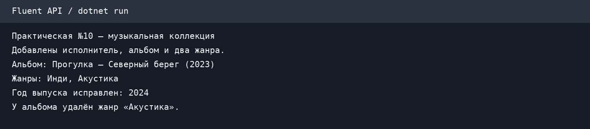

# Практическая работа №10 — конфигурирование базы данных

**Тема:** конфигурирование сущностей и связей средствами Entity Framework Core.  
**Язык:** C#, .NET 8, PostgreSQL.  
**Задание придумано самостоятельно.** Вместо примера преподавателя используется музыкальная коллекция.

## Цель

Научиться задавать имена таблиц и столбцов, обязательные поля, ограничения длины, первичные и внешние ключи, связи один-ко-многим и многие-ко-многим через Fluent API.

## Придуманное задание — «Музыкальная коллекция»

Написать консольную программу для учёта музыкальных альбомов:

1. **Исполнители** (`Artist`): `Id`, `Name`. Один исполнитель выпускает несколько альбомов.
2. **Альбомы** (`Album`): `Id`, `Title`, `Year`, `ArtistId`. У альбома один исполнитель.
3. **Жанры** (`Genre`): `Id`, `Name`. Альбом может относиться к нескольким жанрам.
4. **Альбом–жанр** (`AlbumGenre`): `AlbumId`, `GenreId`, составной ключ.

В `MusicContext.OnModelCreating` настроить:
- названия таблиц `artists`, `albums`, `genres`, `album_genres`;
- названия столбцов (например, `release_year`, `artist_id`);
- обязательные имена и названия, ограничения длины (40, 60, 80 символов);
- связь **один-ко-многим** между исполнителем и альбомами;
- связь **многие-ко-многим** между альбомами и жанрами через `AlbumGenre`.

Программа добавляет исполнителя, альбом и два жанра, выводит связанные записи, исправляет год выпуска, удаляет одну связь с жанром.

## Структура

```text
PracticalWork10/
├── MusicCollection/
│   ├── MusicCollection.csproj
│   ├── Program.cs
│   ├── MusicContext.cs
│   ├── Models/
│   │   ├── Artist.cs
│   │   ├── Album.cs
│   │   ├── Genre.cs
│   │   └── AlbumGenre.cs
│   └── Migrations/       # миграции EF Core
├── images/
│   └── music.png
└── README.md
```

## Запуск

Нужны .NET SDK 8 и PostgreSQL. В PostgreSQL создать отдельную базу:

```sql
CREATE DATABASE practice10_music;
```

По умолчанию используется строка подключения для локального PostgreSQL: `Host=localhost;Port=5432;Database=practice10_music;Username=postgres;Password=postgres`. Её можно заменить переменной окружения `DB_CONNECTION_10`.

Из корня репозитория выполнить:

```bash
dotnet tool install --global dotnet-ef --version 8.0.8
dotnet ef migrations add InitialCreate --project PracticalWork10/MusicCollection/MusicCollection.csproj --output-dir Migrations
dotnet ef database update --project PracticalWork10/MusicCollection/MusicCollection.csproj
dotnet run --project PracticalWork10/MusicCollection/MusicCollection.csproj
```

Если миграция уже есть в папке `Migrations`, снова выполнять `migrations add` не нужно.

## Ожидаемый вывод

```text
Практическая №10 — музыкальная коллекция
Добавлены исполнитель, альбом и два жанра.
Альбом: Прогулка — Северный берег (2023)
Жанры: Инди, Акустика
Год выпуска исправлен: 2024
У альбома удалён жанр «Акустика».
```

## Скриншот

Изображение создаётся из реального вывода программы после её запуска в GitHub Actions.



## Вывод

С помощью Fluent API в `OnModelCreating` настроены названия таблиц и столбцов, ограничения полей и две разновидности связей. Миграция переносит настройки в PostgreSQL.

## Ответы на контрольные вопросы

1. **Для чего нужна конфигурация?** Чтобы определить, какие таблицы, столбцы, ключи и связи создаёт EF Core.
2. **Data Annotations и Fluent API?** Первые задаются атрибутами прямо над свойствами, второй — методами в `OnModelCreating`.
3. **Как задать связи?** Для один-ко-многим используются `HasOne` и `WithMany`, для многие-ко-многим — промежуточная таблица с двумя внешними ключами.
4. **Как ограничить строки?** Методы `IsRequired()` и `HasMaxLength(...)`.
5. **Как применить изменения к БД?** Создать миграцию через `dotnet ef migrations add` и применить через `dotnet ef database update`.
