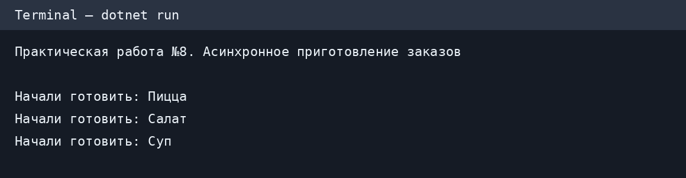
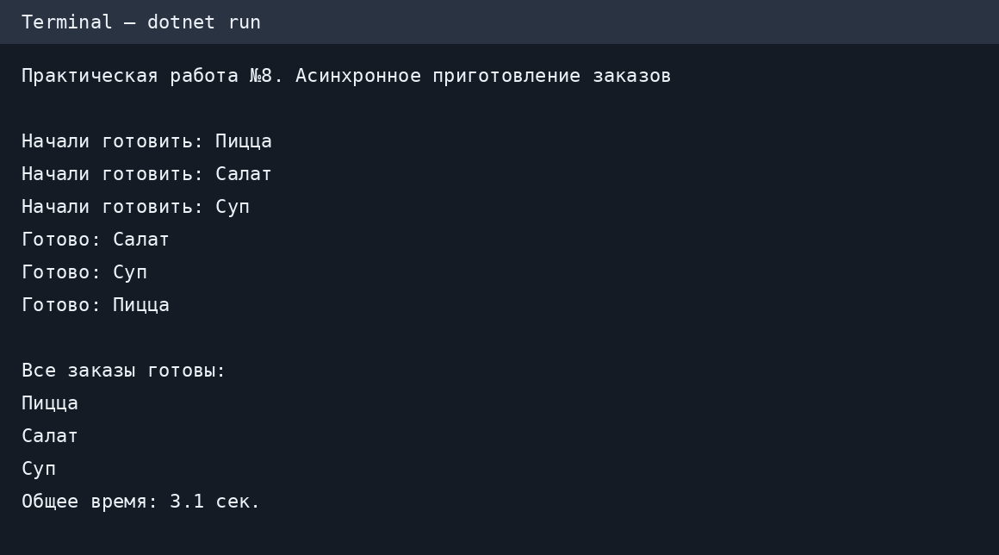

# Практическая работа №8 — Task и async/await

**Язык:** C#  
**Тема:** Асинхронное программирование с помощью `Task` и `async/await`

## Цель работы

Научиться создавать несколько асинхронных задач и ожидать их завершения без последовательного выполнения.

## Придуманное задание

**«Асинхронное приготовление заказов»**

В кафе одновременно готовят три заказа:

1. Пицца — 3 секунды.
2. Салат — 1 секунда.
3. Суп — 2 секунды.

Нужно написать консольную программу, которая:

1. Создаёт метод `CookAsync` для имитации приготовления с помощью `Task.Delay`.
2. Запускает три задачи одновременно.
3. Использует `async/await` и `Task.WhenAll`, чтобы дождаться всех заказов.
4. Выводит сообщения о начале и завершении каждого заказа.
5. Выводит список готовых заказов и общее время приготовления.

## Структура проекта

```text
PracticalWork8/
├── AsyncDemo/
│   ├── AsyncDemo.csproj
│   └── Program.cs
├── images/
│   ├── screenshot1.png
│   └── screenshot2.png
├── .gitignore
└── README.md
```

## Как запустить

Установить .NET SDK 8 или новее, затем из папки `PracticalWork8` выполнить:

```bash
dotnet run --project AsyncDemo/AsyncDemo.csproj
```

## Пример вывода

```text
Практическая работа №8. Асинхронное приготовление заказов

Начали готовить: Пицца
Начали готовить: Салат
Начали готовить: Суп
Готово: Салат
Готово: Суп
Готово: Пицца

Все заказы готовы:
Пицца
Салат
Суп
Общее время: 3.0 сек.
```

Время может немного отличаться в зависимости от компьютера.

## Скриншоты

Изображения созданы автоматически из вывода реально запущенной программы при проверке в GitHub Actions.





## Объяснение

- `Task<string>` представляет задачу, которая вернёт строку.
- `async` позволяет использовать `await` внутри метода `CookAsync`.
- `Task.Delay` имитирует приготовление без блокировки потока.
- `Task.WhenAll` ожидает завершения всех трёх задач.
- `Stopwatch` измеряет общее время работы программы.

## Результат

Три заказа готовятся одновременно, поэтому всё занимает примерно 3 секунды, а не 6 секунд, как при последовательном ожидании.

## Ответы на контрольные вопросы

1. **Чем Task отличается от Thread?** `Thread` — отдельный поток, а `Task` — представление выполняемой операции. Для каждой `Task` не обязательно создавать новый поток.
2. **Для чего async и await?** `async` разрешает использовать `await` в методе, а `await` асинхронно ожидает завершения задачи.
3. **Как ожидать несколько задач?** С помощью `await Task.WhenAll(tasks)`.
4. **Что произойдёт при использовании Task.Result без await?** Если задача ещё не завершена, `Result` заблокирует текущий поток до получения результата; в некоторых приложениях это может привести к взаимной блокировке.
5. **Преимущества асинхронного программирования?** Приложение может оставаться отзывчивым во время ожидания, а независимые операции ввода-вывода могут выполняться одновременно.
