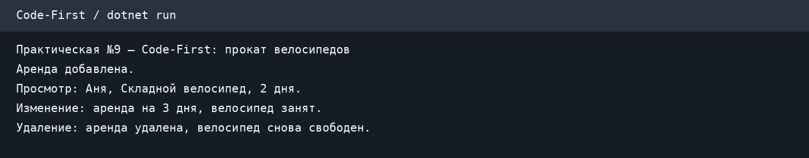
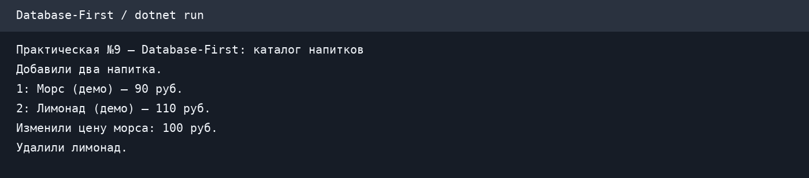

# Практическая работа №9 — Code-First и Database-First

**Тема:** два подхода к работе с базой данных через Entity Framework Core.  
**Язык:** C#, .NET 8, PostgreSQL.  
**Задания придуманы самостоятельно.** Пример преподавателя со студентами и курсами не используется.

## Цель

Показать оба подхода: создание структуры базы по C#-классам и создание C#-классов по готовой базе. Выполнить добавление, чтение, изменение и удаление данных (CRUD).

## Задание 1. Code-First — прокат велосипедов

В небольшом пункте проката ведут список велосипедов, клиентов и аренд.

- `Bike`: номер, модель, доступность.
- `Customer`: номер, имя.
- `Rental`: номер, ссылки на велосипед и клиента, длительность в днях.
- Связи: один клиент может иметь несколько аренд, один велосипед — несколько аренд.
- Программа создаёт аренду, выводит её, меняет срок и доступность велосипеда, удаляет аренду.

Используются классы из каталога `CodeFirstBikeRental`, контекст `BikeRentalContext`, миграции EF Core.

## Задание 2. Database-First — каталог напитков

Небольшое кафе хранит напитки, их названия и цены.

- Сначала таблица `drinks` создаётся скриптом `DatabaseFirstDrinks/create_tables.sql`.
- Затем модель `Drink` и `DrinksContext` получаются из этой таблицы командой `scaffold`.
- Программа добавляет два напитка, показывает каталог, меняет цену и удаляет один напиток.

## Запуск

Нужны .NET SDK 8, PostgreSQL и инструмент `dotnet-ef`. Команды выполнять в терминале из корня репозитория:

```bash
dotnet tool install --global dotnet-ef --version 8.0.8
```

Создать в PostgreSQL две **отдельные** базы:

```sql
CREATE DATABASE practice9_codefirst;
CREATE DATABASE practice9_drinks;
```

В примере используется локальный PostgreSQL (`localhost:5432`, пользователь `postgres`, пароль `postgres`). Если у тебя другие реквизиты, укажи свои строки подключения в переменных окружения `DB_CONNECTION_9_CODEFIRST` и `DB_CONNECTION_9_DATABASEFIRST`. Настоящие пароли в GitHub загружать не нужно.

### Code-First

```bash
dotnet ef migrations add InitialCreate --project PracticalWork9/CodeFirstBikeRental/CodeFirstBikeRental.csproj --output-dir Migrations
dotnet ef database update --project PracticalWork9/CodeFirstBikeRental/CodeFirstBikeRental.csproj
dotnet run --project PracticalWork9/CodeFirstBikeRental/CodeFirstBikeRental.csproj
```

Если папка `Migrations` уже есть, **повторно создавать** миграцию не надо — достаточно команды `database update`.

### Database-First

Сначала создать таблицу в базе `practice9_drinks`:

```bash
psql -h localhost -U postgres -d practice9_drinks -f PracticalWork9/DatabaseFirstDrinks/create_tables.sql
```

Затем создать C#-классы по существующей таблице:

```bash
dotnet ef dbcontext scaffold "Host=localhost;Port=5432;Database=practice9_drinks;Username=postgres;Password=postgres" Npgsql.EntityFrameworkCore.PostgreSQL --project PracticalWork9/DatabaseFirstDrinks/DatabaseFirstDrinks.csproj --output-dir Models --context-dir . --context DrinksContext --namespace DatabaseFirstDrinks.Models --context-namespace DatabaseFirstDrinks --no-onconfiguring --force
dotnet run --project PracticalWork9/DatabaseFirstDrinks/DatabaseFirstDrinks.csproj
```

Файлы `Models/Drink.cs` и `DrinksContext.cs` сохранены в репозитории, поэтому для обычного повторного запуска scaffold не требуется. Не используй `--force`, если вручную изменял эти файлы и не хочешь потерять изменения.

## Ожидаемый результат

```text
Практическая №9 — Code-First: прокат велосипедов
Аренда добавлена.
Просмотр: Аня, Складной велосипед, 2 дня.
Изменение: аренда на 3 дня, велосипед занят.
Удаление: аренда удалена, велосипед снова свободен.
```

```text
Практическая №9 — Database-First: каталог напитков
Добавили два напитка.
...
Изменили цену морса: 100 руб.
Удалили лимонад.
```

Номера записей зависят от содержимого базы.

## Скриншоты

Скриншоты формируются из реального консольного вывода в GitHub Actions и сохраняются в папку `images`.





## Вывод

В Code-First сначала разрабатываются классы и миграции, в Database-First — таблицы SQL. В обоих случаях EF Core позволяет использовать обычные классы и `DbContext` для CRUD.

## Ответы на контрольные вопросы

1. **В чём отличие?** Code-First создаёт структуру БД по классам; Database-First создаёт классы по существующей БД.
2. **Когда какой использовать?** Code-First удобен в новом проекте; Database-First — при готовой базе.
3. **Как выполнить миграцию?** `dotnet ef migrations add InitialCreate`, затем `dotnet ef database update`.
4. **Как сгенерировать классы?** Командой `dotnet ef dbcontext scaffold` с указанием строки подключения и провайдера.
5. **Зачем ORM?** ORM позволяет работать с таблицами как с объектами C#, без ручного написания SQL для каждого запроса.
